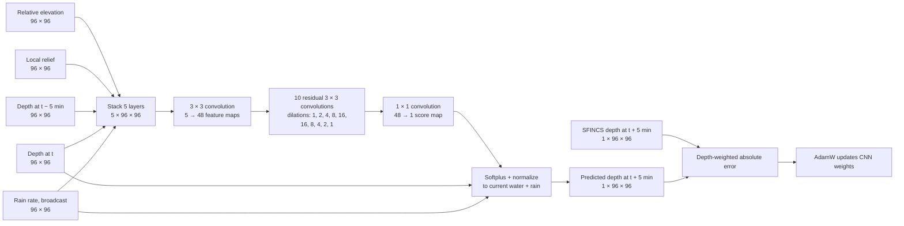

# Visual guide: SFINCS physics pretraining

The selected model is the **plain dilated spatial CNN**. It imitates a
5-minute transition from SFINCS on a 96 × 96 grid of 10 m Bang Kapi cells.
Each 960 m tile supplies one target depth for every cell. The target is
**simulated water depth**, not an observed flood map.

This real training example uses the depth at minutes 5 and 10 to predict
minute 15. The rain rate is 40 mm/hour, adding 3.33 mm to each cell during
the next 5 minutes. The SFINCS target supplies the answer used for training.
The image shows the saved model's one-step prediction and its error on this
example; the weighted training loss is **2.32 mm** and the unweighted mean
absolute error is **0.93 mm**. Those numbers describe this training example,
not a held-out test.

| Input layer | What enters the CNN |
| --- | --- |
| Relative elevation | Tile elevation minus its median, divided by 0.5 m and clipped to ±6 |
| Local relief | Elevation minus a Gaussian neighborhood mean, divided by 0.1 m and clipped to ±6 |
| Previous depth | SFINCS depth at \(t-5\) minutes, divided by 0.05 m |
| Current depth | SFINCS depth at \(t\), divided by 0.05 m |
| Rain rate | Uniform rate divided by 60 mm/hour and copied across all cells |

## Input, network, target, and loss

The convolutions learn which surrounding high and low cells affect the next
depth at a location. Dilation gives the full-resolution CNN a wider field of
view without downsampling. A 1 × 1 local control has the same five input
layers but cannot learn this additional spatial relation.

## The two rules in the training step

**1. Whole-tile water amount.** Let \(h_t\) be current depth, \(r\) the
uniform rain rate, and \(\Delta t=5\) minutes. The CNN produces a nonnegative
raw water map \(u_i\). We rescale it to make its mean equal the available
water:

\[
u_i=\operatorname{softplus}(s_i)+10^{-6},\qquad
\hat h_{t+5,i}=\frac{u_i}{\operatorname{mean}(u)}
\left(\operatorname{mean}(h_t)+r\Delta t\right).
\]

Thus predicted depths are nonnegative and their **total volume equals current
water plus rain** for the closed tile. This rule is built into the output;
the network does not have to learn it.

**2. Match SFINCS depth.** For target depth \(y_i\) in metres, deeper targets
receive weight \(w_i=1+2\min(y_i/0.02,1)\). The loss is

\[
L=\operatorname{mean}_i\left[w_i\,1000\,|\hat h_i-y_i|\right]
\quad\text{millimetres}.
\]

A 0 mm target has weight 1; 10 mm has weight 2; and 20 mm or deeper has weight
3. The model is trained on the next SFINCS state using true earlier states.
At evaluation, it also feeds its **own** predictions back for a three- or
four-step rollout. This is harder because errors can accumulate.

The network has **no face-by-face continuity or downhill rule**. Conservation
of total water does not prove that its local flow paths are physically valid.
The full setup and held-out results are in the
[pretraining report](FLOOD_SFINCS_PHYSICS_PRETRAIN.md).
